<p align="center">
  
</p>

<p align="center">
  <a href="https://vishnurdev.github.io">
    
  </a>
</p>

<p align="center">
  <a href="https://vishnurdev.github.io"></a>
  <a href="mailto:vishnudevbizz@gmail.com"></a>
  <a href="https://discord.gg/AsEy3tRUBx"></a>
</p>

---

### 👨‍💻 About me

```python
class Vishnu:
    role      = "Quality Engineer · Python & JavaScript Developer"
    builds    = ["Discord bots", "AI apps", "Web tools", "Test automation"]
    shipped   = {"Core X": "60+ servers, 28k+ users", "Merchant QR": "live UPI tool", "Zeeva": "AI chat app"}
    mindset   = "If it isn't tested, it isn't done."
    available = True  # open to freelance work
```

### 🚀 Featured work

<table>
  <tr>
    <td width="50%" valign="top">
      <h4>🤖 <a href="https://github.com/vishnurdev/corex-bot">Core X</a></h4>
      All-in-one Discord bot: 18 anti-nuke protections, moderation, 17 AI commands, music and a web dashboard.<br><br>
        <br>
      <sub>Python · discord.py · FastAPI · Docker</sub> · <a href="https://core-x-psi.vercel.app/dashboard"><b>Dashboard ↗</b></a>
    </td>
    <td width="50%" valign="top">
      <h4>💳 <a href="https://github.com/vishnurdev/merchant-qr">Merchant QR</a></h4>
      Splits one big bill into multiple UPI payment QR codes, so customers can pay within their UPI limits.<br><br>
       <br>
      <sub>React · TypeScript · Vite</sub> · <a href="https://merchantqr.vercel.app"><b>Live app ↗</b></a>
    </td>
  </tr>
  <tr>
    <td width="50%" valign="top">
      <h4>⚡ <a href="https://github.com/vishnurdev/ai-chat-app">Zeeva</a></h4>
      Fast AI chat assistant with real-time streaming, chat history and day/night mode. Zero dependencies.<br><br>
       <br>
      <sub>JavaScript · Edge Functions · Vercel</sub> · <a href="https://zeeva-nu.vercel.app"><b>Live demo ↗</b></a>
    </td>
    <td width="50%" valign="top">
      <h4>✅ <a href="https://github.com/vishnurdev/qa-automation-suite">QA Automation Suite</a></h4>
      29 Playwright UI + API tests with page objects, mobile runs, HTML reports and daily CI.<br><br>
       <br>
      <sub>Playwright · JavaScript · GitHub Actions</sub>
    </td>
  </tr>
  <tr>
    <td colspan="2" valign="top">
      <h4>📊 <a href="https://github.com/vishnurdev/sheetdiff">SheetDiff</a></h4>
      Compare two Excel/CSV files and get colour-coded Excel + HTML reports of every added, removed and changed row. <sub>Python · pandas · pytest</sub>
    </td>
  </tr>
</table>

### 🛠️ Tech stack

<p align="center">
  
</p>
<p align="center"><sub>+ Playwright · pytest · pandas · discord.py · Groq · Gemini</sub></p>

### 📈 GitHub activity

<p align="center">
  
  
</p>

### 🤝 How I work

| 1. Understand | 2. Build | 3. Test | 4. Deliver |
|:---:|:---:|:---:|:---:|
| Clear scope, timeline and price in writing | Early previews, so you can steer | Every feature tested before delivery | Deployed, documented and supported |

---

<p align="center">
  <b>Have a project in mind?</b> Discord bot, AI chatbot, web app or test automation, let's build it.<br><br>
  <a href="mailto:vishnudevbizz@gmail.com"></a>
</p>
